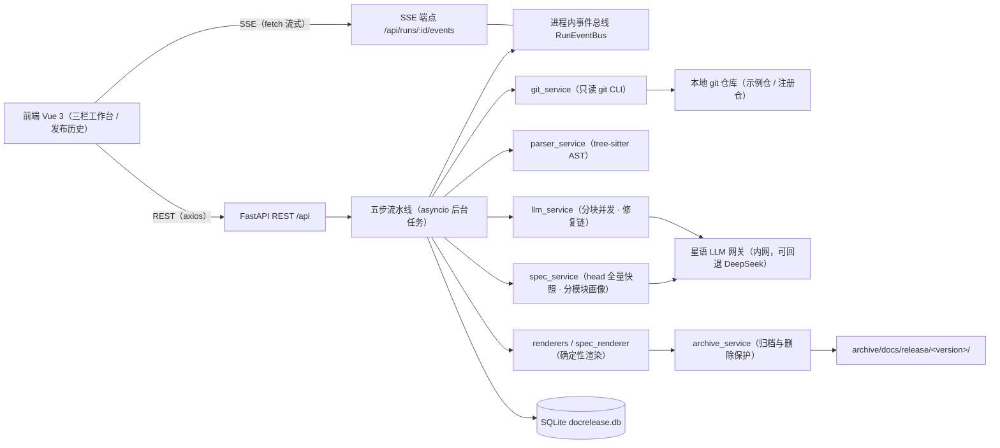
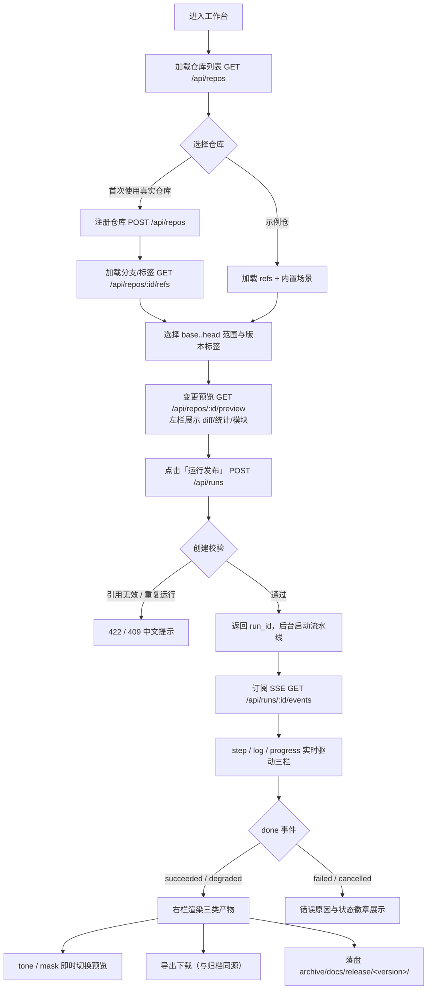
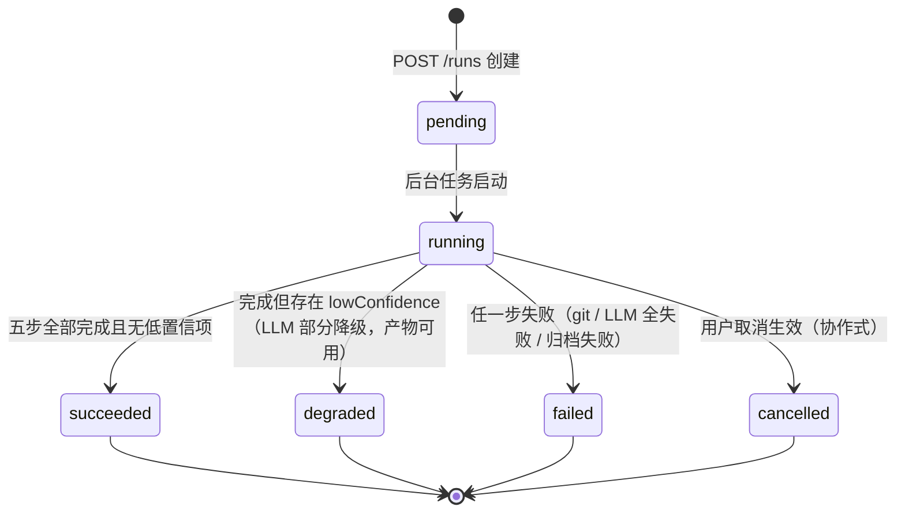
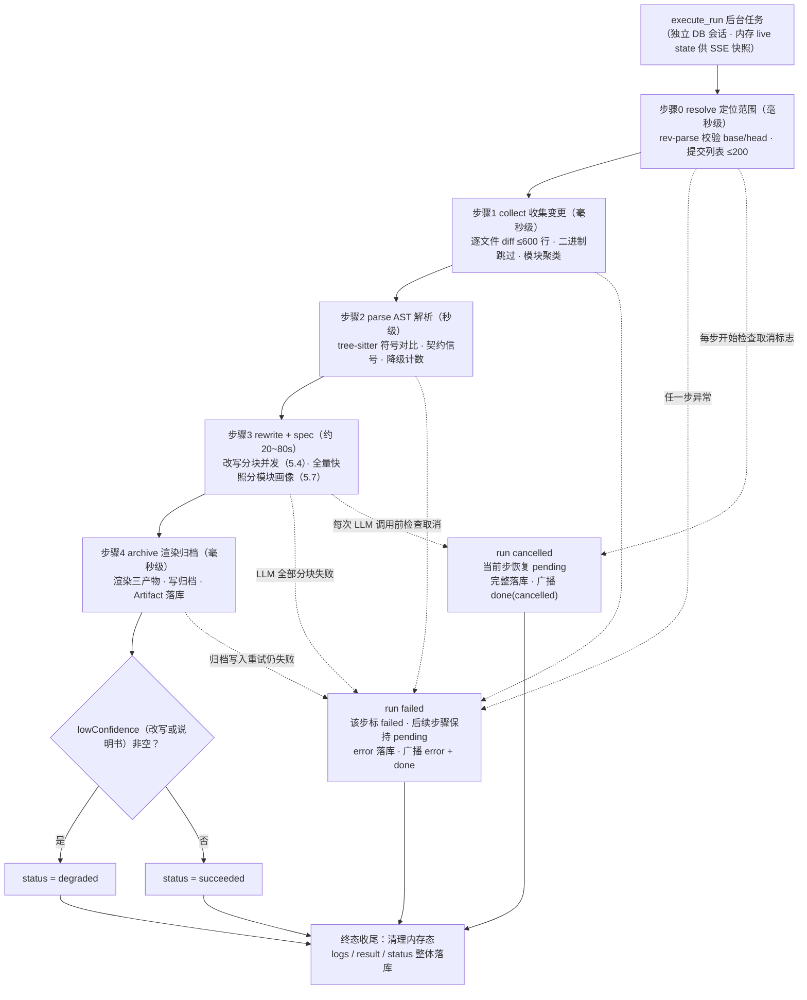
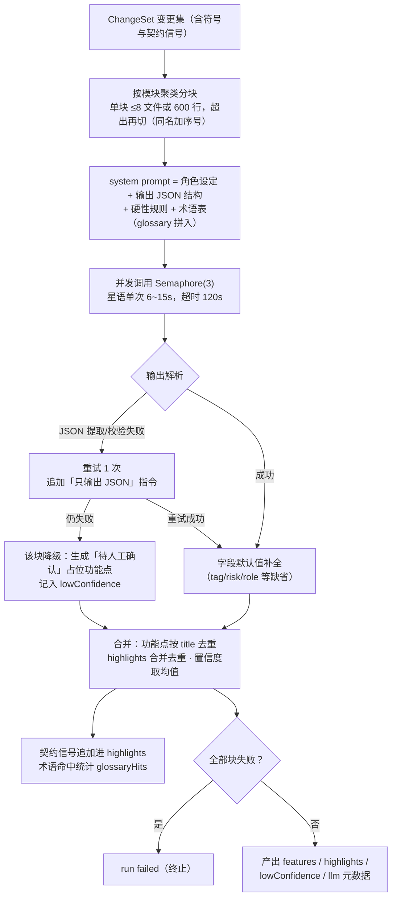
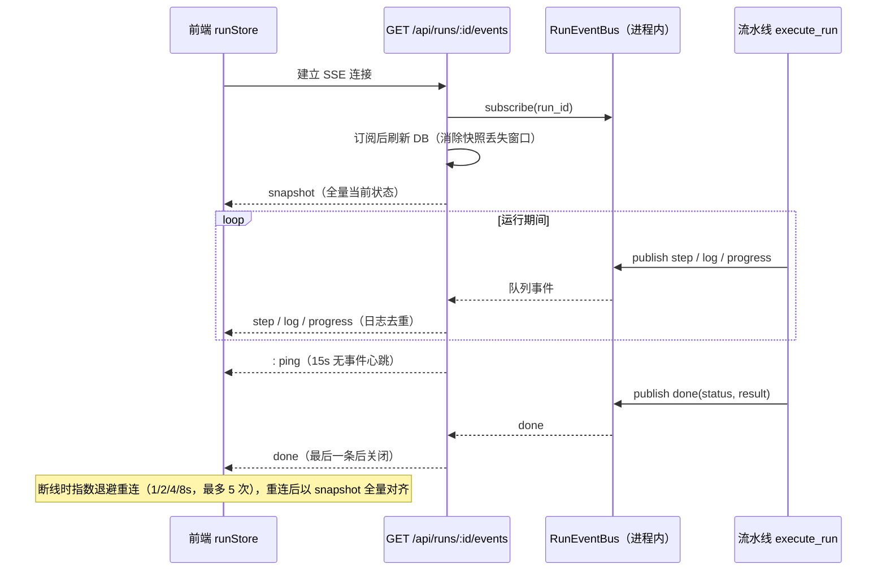
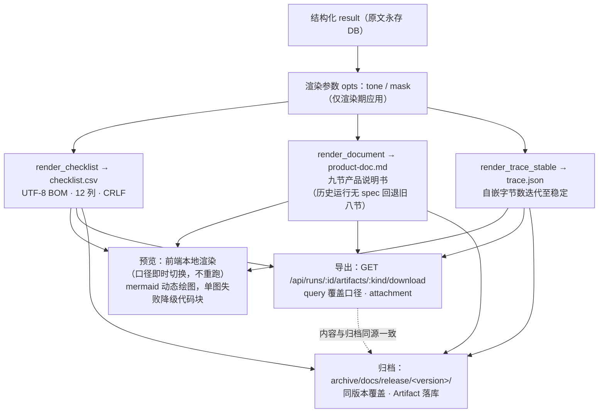
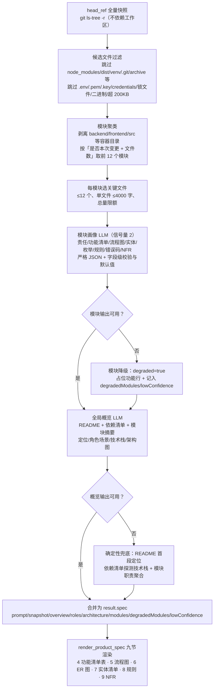
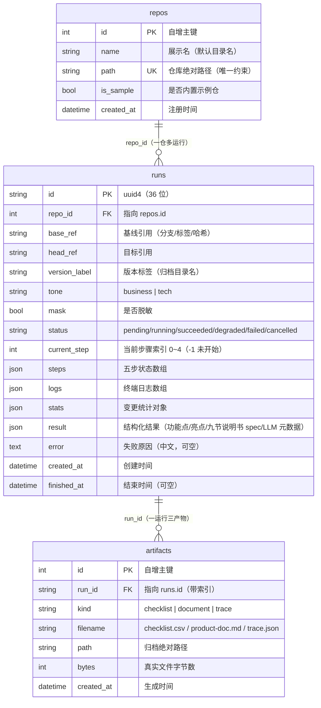

# 释文 DocRelease · 产品说明书

- 文档性质：基于代码解析生成的产品说明，描述**当前已实现**行为（与早期设计文档有出入处以代码为准）
- 解析范围：`doc-release/backend`、`doc-release/frontend`、`doc-release/deploy`
- 生成日期：2026-10-16（分支 dev）

## 目录

1. 项目概述
2. 用户角色与使用场景
3. 系统架构与技术栈
4. 功能清单及核心逻辑
5. 核心流程（各模块流程图）
6. 领域实体关系图（ER 图）
7. 领域实体清单（分模块）
8. 详细规则说明
9. 非功能性需求
- 附录：主要代码依据

---

## 1. 项目概述

**定位**：从代码变更自动生成发布文档的全栈工具。输入任意本地 git 仓库的变更范围（`base..head`），经五步异步流水线处理，输出三类发布交付物：

| 产物 | 归档文件名 | 用途 |
| --- | --- | --- |
| 功能点清单 | `checklist.csv` | 发布检查清单（UTF-8 BOM，Excel 直接打开） |
| 产品说明文档 | `product-doc.md` | 九节产品说明书（项目概述 / 角色场景 / 架构技术栈 / 功能清单 / 核心流程 / ER 图 / 实体清单 / 详细规则 / 非功能需求） |
| 溯源数据 | `trace.json` | 生成过程留痕（范围、流水线、LLM、置信度、产物指纹） |

**核心价值**：把「研发看得懂的 diff」改写为「业务看得懂的发布文档」；同时基于目标版本全量代码快照生成「系统有哪些功能、流程怎么走、领域实体是什么」的产品说明书。LLM 只产出结构化 JSON（功能点改写 + 分模块产品画像），产物由确定性渲染器生成——可溯源、可比对、任意口径可复现。

**首期非目标**：登录认证与多用户权限、配置中心 UI、真实 CI 接入（手动触发）、前端单测框架、ts/tsx/go/py 之外语言的符号级解析（降级文件级）、产物在线编辑。

## 2. 用户角色与使用场景

| 角色 | 定位 | 主要诉求 |
| --- | --- | --- |
| 发布负责人（研发/DevOps） | 操作者：选仓库、选范围、触发/取消运行 | 发布前快速产出文档，掌握破坏性变更与上线动作 |
| 产物消费方（产品/运营/客服/测试） | 阅读者：按口径查看与导出产物 | 业务视角说明、影响范围、验收要点、运营动作 |
| 运维管理员 | 部署与升级 | 内网单机部署、非 root 可装、升级不丢现场数据 |
| 系统（自动） | 流水线执行 | 降级不中断、失败可追溯、绝不静默丢弃变更 |

典型场景：① 发布前预览（内置示例仓三大场景开箱演示）；② 正式发布文档生成（注册真实仓库）；③ 历史回看与按口径补录导出。

## 3. 系统架构与技术栈

| 层 | 选型 |
| --- | --- |
| 后端 | Python 3.11 · FastAPI · SQLAlchemy 2.0 Async · SQLite(aiosqlite) · tree-sitter(语言包) · requests/httpx（星语/DeepSeek） |
| 前端 | Vue 3 · TypeScript · Vite · Pinia · Vue Router · Element Plus（表单类控件）· Axios |
| 交付 | uvicorn 单进程同源托管（页面+API+SSE 同端口）· systemd（root/非 root 双模式）· 源码包+在线 pip |

后端模块：仓库管理（`api/repos.py`）、运行与流水线（`api/runs.py` + `services/pipeline_service.py`）、解析（`git_service` / `parser_service`）、LLM（`llm_service` / `xingyu_api` / `prompts`）、产品画像（`spec_service` + `prompts/spec_v1.py`）、渲染归档（`renderers` / `spec_renderer` / `archive_service`）、装配（`main.py`：lifespan 建表+示例仓、CORS）、路由聚合（`api/router.py`）、静态托管与 SPA 回退（`static_serving.py`）。

前端模块：视图（`ConsoleView` 三栏工作台 / `HistoryView` 历史列表 / `HistoryDetailView` 历史详情）、状态（`repoStore` / `runStore`）、接口层（`client.ts` axios + `sse.ts` 手写 SSE 解析）、产物渲染（marked + DOMPurify + mermaid 动态绘图）。

## 4. 功能清单及核心逻辑

> 优先级口径：P0=核心链路（缺一则产品不成立）；P1=重要辅助能力；P2=低频/边缘操作。均为首期已实现功能。

### 4.1 仓库管理模块

| 序号 | 功能简介 | 核心逻辑 | 涉及角色 | 优先级 |
| --- | --- | --- | --- | --- |
| 1 | 仓库列表查询 | `GET /api/repos` 返回全部注册仓库；示例仓 order-center 由后端首次启动幂等生成并自动登记（`is_sample=true`） | 发布负责人 | P0 |
| 2 | 注册本地 git 仓库 | `POST /api/repos`：校验路径存在且 `rev-parse --git-dir` 成功（否则 400）；路径全局唯一（重复 409）；名称缺省取目录名 | 发布负责人 | P0 |
| 3 | 删除仓库注册 | `DELETE /api/repos/{id}`：存在任何运行记录时 400 拒绝（审计保护）；示例仓删除后重启自动重建 | 发布负责人 | P2 |
| 4 | 分支/标签枚举 | `GET /api/repos/{id}/refs`：`for-each-ref` 枚举分支与标签（含短哈希），`symbolic-ref` 取默认分支 | 发布负责人 | P0 |
| 5 | 内置场景推荐 | `GET /api/repos/{id}/scenarios`：仅示例仓返回补丁（v2.13.3..v2.13.4）/功能（v2.13.3..v2.14.0）/大版本（v2.14.0..v3.0.0）3 个预设范围 | 发布负责人/演示 | P1 |
| 6 | 变更预览 | `GET /api/repos/{id}/preview?base&head`：numstat+name-status 统计、逐文件 `-U3` diff（单文件 ≤300 行截断并标记）、按路径前两级聚类为模块；ref 无效或范围为空 422 | 发布负责人 | P0 |

### 4.2 运行与流水线模块

| 序号 | 功能简介 | 核心逻辑 | 涉及角色 | 优先级 |
| --- | --- | --- | --- | --- |
| 7 | 创建运行任务 | `POST /api/runs`：校验仓库存在（404）、tone 枚举（422）、base/head 引用可解析（422）；`version_label` 缺省取 head_ref；同仓库同范围同时仅一个进行中（加锁原子查重，重复 409）；创建后 `asyncio.create_task` 后台执行流水线 | 发布负责人 | P0 |
| 8 | 五步流水线执行 | resolve→collect→parse→rewrite+spec→archive 顺序执行（步骤3 内部两路并发）；每步状态/起止时间/耗时实时落库并广播；任一步失败即 run failed，后续步骤保持 pending | 系统 | P0 |
| 9 | 步骤0 定位范围 | rev-parse 校验两端引用，log 拉取提交列表（≤200 条），计算提交数/文件数/跨度天数 | 系统 | P0 |
| 10 | 步骤1 收集变更 | 逐文件 diff（单文件 ≤600 行截断）；二进制文件跳过 patch 仅留条目；文件数 >200 时超出的仅统计不取 patch；模块聚类 | 系统 | P0 |
| 11 | 步骤2 AST 解析 | tree-sitter 对 base/head 双版本做符号提取与对比（.ts/.tsx/.go/.py），输出新增/删除/签名变更；提取契约信号（导出常量值变更、导出符号删除、接口路径增删）；未知语言或解析异常降级为文件级并计数，不中断整体 | 系统 | P0 |
| 12 | 步骤3 LLM 改写与产品说明书生成 | 并发两路：① diff 按模块分块（单块 ≤8 文件或 600 行），信号量 3 并发调用星语，修复链 + 单块降级；② head 全量快照按模块聚类（≤12 模块，每模块 ≤12 文件/4000 字），信号量 2 并发产出模块画像，再汇总全局概览；任一路 LLM 失败按块/按模块降级，不影响另一路；改写全部失败才终止 | 系统 | P0 |
| 13 | 步骤4 渲染归档 | 确定性渲染三类产物（12 列 checklist.csv / 九节 product-doc.md / trace.json）→ 写入 `archive/docs/release/<version>/` → Artifact 记录落库；写入失败重试 1 次仍失败则 run failed | 系统 | P0 |
| 14 | 取消运行 | `POST /api/runs/{id}/cancel` 设协作式取消标志（非进行中 409）；生效点为每步开始与每次 LLM 调用前；取消后当前步恢复 pending、完整落库并广播 done(cancelled) | 发布负责人 | P1 |

### 4.3 实时交互模块（SSE 与工作台）

| 序号 | 功能简介 | 核心逻辑 | 涉及角色 | 优先级 |
| --- | --- | --- | --- | --- |
| 15 | SSE 实时推送 | `GET /api/runs/{id}/events`：进程内事件总线（run_id→订阅队列集合）广播 snapshot/step/log/progress/done/error；15s 无事件发 `: ping` 心跳防代理超时；日志按 (ts,tag,message) 去重防重连重复；运行已结束时只发 snapshot+done 即关闭 | 发布负责人 | P0 |
| 16 | 断线重连 | 前端 fetch+ReadableStream+TextDecoder 手动解析 SSE；指数退避 1/2/4/8s 最多 5 次；重连后以 snapshot 全量对齐，不依赖事件补发 | 发布负责人 | P1 |
| 17 | 三栏工作台 | 左栏 diff 预览、中栏五步列表+进度条+终端日志（channel 着色、自动滚动）、右栏三 tab 产物预览；运行中禁切换/禁重复运行、可取消；页面刷新后先查详情再重新订阅恢复现场 | 发布负责人 | P0 |
| 18 | 跳过动画 | 保留演示版「跳过」按钮：仅跳过前端动画节奏，不干预后端执行 | 发布负责人 | P2 |

### 4.4 产物模块

| 序号 | 功能简介 | 核心逻辑 | 涉及角色 | 优先级 |
| --- | --- | --- | --- | --- |
| 19 | 三类产物确定性渲染 | 纯函数渲染器（不访问网络/DB）：CSV（UTF-8 BOM、12 列表头）、MD（九节产品说明书；历史运行无 spec 时回退旧八节发布说明）、trace.json（自嵌 artifacts 字节数迭代至稳定，并记录 spec 元数据）；同输入必同输出 | 系统/产物消费方 | P0 |
| 20 | 口径即时切换 | tone（business/tech）与 mask 只在渲染期应用，结构化 result 永存原文；切换不重跑流水线，预览/导出即时生效，保证预览/导出/归档三路同源 | 产物消费方 | P0 |
| 21 | 产物预览 | 运行结束后前端用结构化 result 本地渲染三 tab；产品说明中的 mermaid 流程图/ER 图动态绘制为图形，单图语法错误仅该图降级为代码块；未完成时空态、导出按钮禁用 | 产物消费方 | P0 |
| 22 | 产物导出下载 | `GET /api/runs/{id}/artifacts/{kind}/download`：query 的 tone/mask 覆盖运行默认口径，attachment 下载（checklist.csv / product-doc.md / trace.json），内容与归档同源一致 | 产物消费方 | P0 |
| 23 | 产物归档 | 固定写入 `archive/docs/release/<version>/` 三个文件；同版本二次运行覆盖（发布语义：以最新为准），trace 的 runId 指向最新运行 | 系统 | P0 |

### 4.5 发布历史模块

| 序号 | 功能简介 | 核心逻辑 | 涉及角色 | 优先级 |
| --- | --- | --- | --- | --- |
| 24 | 历史列表 | `GET /api/runs?limit&offset` 分页（limit 夹取 1..100，默认 20），按创建时间倒序；摘要不含 steps/logs/result 大字段 | 发布负责人/产物消费方 | P1 |
| 25 | 历史详情回看 | `GET /api/runs/{id}`：步骤耗时、终端日志、统计、结构化结果、产物清单（含字节数）；可按任意口径重新导出 | 产物消费方 | P1 |
| 26 | 删除历史运行 | `DELETE /api/runs/{id}`：进行中 409 拒绝；删 Artifact 记录；归档目录仅当其 trace.json 的 runId 与被删运行一致才删除（防误删被后续运行覆盖的同版本归档） | 发布负责人 | P2 |

### 4.6 支撑与部署模块

| 序号 | 功能简介 | 核心逻辑 | 涉及角色 | 优先级 |
| --- | --- | --- | --- | --- |
| 27 | 示例仓库自动生成 | 首次启动 lifespan 幂等生成 order-center（4 个标签、3 大场景、2026-06~10 真实提交时间线、TS/TSX/Go 真实 diff）并注册为示例仓 | 演示/评估 | P1 |
| 28 | 术语表口径 | 内置 glossary.json（20+ 条术语及别名）拼入 LLM 系统提示词统一表述口径；对产物文本做别名命中统计记入 trace（glossaryHits）；加载一次缓存，改文件需重启 | 系统 | P1 |
| 29 | 健康检查 | `GET /api/health` 返回 ok，供部署验证与探活 | 运维 | P1 |
| 30 | 单进程同源托管 | uvicorn 单端口（部署默认 8080）托管前端静态产物+API+SSE；SPA history 路由刷新回退 index.html；`/api` 前缀 404 不被回退掩盖，且补偿 405/Allow 与尾斜杠 307 重定向语义 | 运维 | P1 |
| 31 | 双模式部署 | 开发机 `build_package.ps1` 出源码包（backend+static+deploy，不含 wheels）；`install.sh` 按 uid 自动判定：root 系统级（/opt/docrelease+系统用户+系统单元）或非 root 用户级（~/docrelease+`systemctl --user`）；在线 pip 装依赖（PIP_INDEX_URL 可覆盖）；升级 rsync 排除 venv/.env/db/archive/sample_repo 保留现场；30s 健康检查硬超时；用户级做 lingering 检测提示 | 运维 | P1 |

## 5. 核心流程（各模块流程图）

### 5.1 用户旅程总流程

### 5.2 运行状态机

### 5.3 五步流水线执行流程（含失败与取消分支）

> 一致性修正：第 5 步渲染 trace 时自身仍为 active，trace 中 pipeline 会失真；五步全部结束后重算 pipeline 并重写 trace.json、更新 Artifact.bytes，保证归档与事实一致。

> 步骤3 并发语义：改写与产品画像互不依赖，同属步骤3；改写全部块失败 ⇒ 步骤3 failed、运行终止；说明书单模块/概览失败只降级，不中断归档。

### 5.4 LLM 业务化改写流程（步骤3 内部 · 分支一）

### 5.5 SSE 事件流交互

### 5.6 产物渲染、导出与归档流程

### 5.7 产品说明书生成流程（步骤3 内部 · 分支二）

> 取消沿现有路径：任一阶段检查到取消标志即抛 `RunCancelled`，已启动的模块任务全部取消并等待退出。说明书生成除取消外不向外抛异常，保证不影响改写与归档。

## 6. 领域实体关系图（ER 图）

伴生资源（非数据库实体，但属领域的一部分）：

- 归档目录树 `archive/docs/release/<version>/`（每版本固定三文件）；
- 配置文件 `glossary.json`（术语表）、`.env`（LLM 网关与并发参数）；
- 示例仓 `sample_repo/order-center`（种子脚本幂等生成）。

## 7. 领域实体清单（分模块）

### 7.1 仓库模块 —— `repos`

| 字段 | 类型 | 约束/默认 | 说明 |
| --- | --- | --- | --- |
| id | Integer | PK 自增 | 主键 |
| name | String(200) | — | 展示名，注册时缺省取目录名 |
| path | String(1000) | unique | 本地 git 仓库绝对路径 |
| is_sample | Boolean | default False | 是否内置示例仓（控制场景接口返回） |
| created_at | DateTime | default utcnow | 注册时间 |

### 7.2 运行模块 —— `runs`

| 字段 | 类型 | 约束/默认 | 说明 |
| --- | --- | --- | --- |
| id | String(36) | PK，uuid4 | 运行标识 |
| repo_id | Integer | FK→repos.id | 所属仓库 |
| base_ref / head_ref | String(200) | 非空 | 变更范围两端引用 |
| version_label | String(200) | 非空 | 版本标签；请求缺省时取 head_ref；拒绝 `/ \ : ..`（防目录穿越） |
| tone | String(20) | default `business` | 展示口径（business/tech） |
| mask | Boolean | default False | 是否脱敏 |
| status | String(20) | default `pending` | 六态：pending/running/succeeded/degraded/failed/cancelled |
| current_step | Integer | default -1 | 当前步骤索引（0~4；终态为 5） |
| steps | JSON | `[]` | 步骤记录数组 |
| logs | JSON | `[]` | 终端日志数组 |
| stats | JSON | `{}` | 变更统计 |
| result | JSON | 可空 | 结构化结果（成功/降级后写入） |
| error | Text | 可空 | 失败原因（中文） |
| created_at / finished_at | DateTime | — | 起止时间 |

**`steps` 元素结构**：`{index, name, status(pending/active/done/failed), started_at, finished_at, duration_ms, detail}`；五步名称固定为：定位仓库与变更范围 / 收集变更（diff 与统计）/ AST 解析变更结构 / LLM 业务化改写与产品说明书生成 / 产物生成并归档。

**`logs` 元素结构**：`{ts, channel, tag, message}`（channel 决定前端着色）。

**`stats` 结构**：`{commits, files, modules, added, removed, days}`。

**`result` 结构（核心领域对象）**：

- `features[]` 功能点：`{tag, risk, breaking, title, biz, tech, visible, scope, acceptance, action, role, paths[]}`（缺失字段按默认值补全）；
- `highlights[]` 发布亮点短句（含契约信号追加项）；
- `lowConfidence[]` 低置信/待人工复核项（非空 ⇒ run 为 degraded）；
- `llm` 元数据：`{provider, model, prompt(docrelease/v1), confidence, inputChars, outputChars, glossaryHits}`；
- `contractSignals[]` 契约信号：`{kind, path, message}`；
- `spec` 九节说明书结构化数据：`{prompt(spec/v1), snapshot{ref, files, modules, skipped}, overview{name, positioning, problems[], scope[]}, roles[{role, scenarios[]}], architecture{stack[{layer, tech, note}], modules[{name, responsibility}], diagram}, modules[{name, changed, degraded, files[], responsibility, functions[{name, logic, roles[], priority}], flows[{title, mermaid}], entities[{name, table, fields[{name, type, constraints, note}], relations[{target, label, cardinality}]}], enums[{name, values[]}], rules[{topic, points[]}], errorCodes[{scene, code, ui}], nfr{performance/security/reliability/deployment/maintainability/extensibility/compatibility[]}}], degradedModules[], lowConfidence[], llm{calls, okCalls, inputChars, outputChars}}`；
- `meta`：`{runId, repoName, version, branch, headShort, range, trigger, generatedAt, stats, modules, pipeline[]}`。

### 7.3 产物模块 —— `artifacts`

| 字段 | 类型 | 约束/默认 | 说明 |
| --- | --- | --- | --- |
| id | Integer | PK 自增 | 主键 |
| run_id | String(36) | FK→runs.id，索引 | 所属运行 |
| kind | String(20) | — | checklist / document / trace |
| filename | String(200) | — | 归档文件名（固定三种） |
| path | String(1000) | — | 归档绝对路径 |
| bytes | Integer | default 0 | 真实文件字节数 |
| created_at | DateTime | default utcnow | 生成时间 |

### 7.4 非持久化领域对象（内存态/值对象）

| 对象 | 归属 | 关键字段 |
| --- | --- | --- |
| ChangeSet 变更集 | 流水线步骤1产物 | `{base, head, commits[], files[], stats, modules[]}`；file：`{status(a/m/d), path, old_path?, added, removed, binary, truncated, lines[{t,s}], ast, contract_signals}` |
| ModuleSnapshot 模块快照 | spec_service 输入 | `{name, changed, tree[], files[{path, content, truncated, label, lang}], changes[]}`；head 全量代码按模块限量裁剪后的 LLM 输入 |
| Spec 产品画像 | spec_service 输出（result.spec） | 九节说明书的结构化输入：概览/角色/架构/分模块功能、流程、实体、规则、错误码、NFR |
| Symbol 符号 | 解析器输出 | `{name, kind, signature, value?}`；对比后归入 added/removed/changed |
| GlossaryTerm 术语 | glossary.json | `{term, aliases[], note}`（20+ 条） |
| Scenario 场景 | seed_data 预设 | `{id, name, short, version, base, head, description}`（仅示例仓 3 条） |
| SSE 事件 | 事件总线 | snapshot / step / log / progress / done / error 六类 + ping 注释行 |
| LiveState 运行期内存态 | pipeline_service | 运行中的 steps/logs/stats/result 快照（终态后清理，SSE 转走 DB） |

### 7.5 枚举字典

| 枚举 | 取值 |
| --- | --- |
| RunStatus | pending / running / succeeded / degraded / failed / cancelled |
| StepStatus | pending / active / done / failed |
| ArtifactKind | checklist / document / trace |
| Tone | business / tech |
| FeatureTag | 新增功能 / 体验优化 / 缺陷修复 / 技术重构 / 破坏性变更 |
| RiskLevel | 高 / 中 / 低 |
| Role（功能点负责角色） | 产品 / 研发 / 测试 / 运营 / 客服 |
| FileStatus | a（新增）/ m（修改）/ d（删除） |
| LogChannel | step / warn / error（前端按通道着色） |

## 8. 详细规则说明

### 8.1 仓库注册与删除

- 注册：路径必须是存在的目录且 `git rev-parse --git-dir` 成功，否则 400（中文消息）；路径已注册 409；name 可选，缺省取目录名；注册仓库 `is_sample=false`。
- 删除：该仓库存在任意运行记录 ⇒ 400 拒绝（审计保护）；示例仓被删后，服务重启时 lifespan 幂等重建并重新登记。

### 8.2 运行创建与并发控制

- 校验顺序：仓库存在（404）→ tone ∈ {business, tech}（422）→ base/head 引用可 rev-parse 解析（422）→ 查重（409）。
- 防重规则：同仓库 + 同 base + 同 head，且存在 pending/running 状态的运行 ⇒ 409「相同范围已有运行中的任务」；查重与插入置于 `asyncio.Lock` 内原子执行，防并发绕过。
- version_label：请求可传；为空时取 head_ref；Pydantic 校验拒绝包含 `/ \ :` 或 `..` 的值（该值将作为归档目录名）。
- 创建成功即返回 201 + RunDetail（pending），流水线由 `asyncio.create_task` 后台执行，与请求生命周期解耦（自带 DB 会话）。

### 8.3 流水线状态与失败处理

- 步骤状态：pending → active → done/failed；每步开始广播 `step(active)+progress`，结束广播 `step(done/failed)` 并落库（steps 为原地变异 JSON 列，落库时强制 `flag_modified`）。
- 任一步抛异常：该步标 failed，其余未执行步骤保持 pending，run 转 failed，error 以中文落库（GitError 加「Git 错误：」前缀），广播 error + done。
- 终态判定：五步全部完成 ⇒ 改写或说明书的 `lowConfidence` 任一非空为 degraded，否则 succeeded；终态后清理内存 live state（此后 SSE 快照走 DB）。
- 一致性修正：第 5 步渲染 trace 时自身仍为 active；五步全部结束后重算 pipeline 并重写 trace.json、更新 Artifact.bytes，保证归档与事实一致。

### 8.4 取消规则

- 协作式取消：`POST /runs/{id}/cancel` 仅置内存标志（非进行中 409）；生效点为每步开始与每次 LLM 调用前。
- 生效后：当前步骤恢复 pending，run 转 cancelled，error=「运行已取消」，完整落库并广播 done(cancelled)；步骤3 两路任务（改写分块与模块画像）一并取消并等待退出，避免悬挂。

### 8.5 git 访问与限额（安全）

- 全部只读命令（rev-parse/log/diff/for-each-ref/show/cat-file/ls-tree/symbolic-ref）；一律 subprocess 列表参数（无 shell），`GIT_TERMINAL_PROMPT=0`，超时 60s，utf-8+replace 解码。
- 注入防护：ref 拒绝以 `-` 开头或为空；被检仓库路径只来自 DB 注册记录。
- 限额：提交列表 ≤200；文件 patch 收集 ≤200 个文件（超出仅统计）；预览单文件 diff ≤300 行、流水线 ≤600 行，超出截断并置 `truncated: true`；二进制文件（numstat 为 `-`）跳过 patch。
- 文件内容一律 `git show <ref>:<path>` / `git cat-file --batch` 读取，不依赖工作区 checkout 状态；重命名文件解析 `{a => b}` 语法并从旧路径读基线。
- 全量快照限额（步骤3 产品画像）：模块 ≤12；每模块文件 ≤12；单文件 ≤4000 字；单模块提示词总量兜底；依赖/构建/缓存目录、`.env*`/`*.pem`/`*.key`/`credentials*`/`id_rsa*`/锁文件/二进制/超 200KB 文件一律不读入提示词。

### 8.6 解析与契约信号

- 语言映射：.ts→typescript、.tsx→tsx、.go→go、.py→python，其余未知。
- 符号提取口径：TS/TSX 取 export 声明（function/class/interface/type/const）；Go 取首字母大写导出（func/method/type/const/var）；Python 取模块级 def/class 与全大写常量。签名=声明首行规范化文本；同名签名变化记 changed。
- 契约信号三类：导出常量字面量值变更（如 `REFUND_WINDOW_DAYS 7 → 15`）、导出符号删除、路由/接口路径增删（正则识别 `/v\d` 等）；信号进日志（⚠ 着色）与 highlights。
- 降级：语言未知或解析异常 ⇒ 该文件仅保留文件级（路由）信号、`degraded=true` 并计数；单文件异常不中断整体。

### 8.7 LLM 协作规则

- provider 路由：`LLM_PROVIDER` = xingyu（默认）/ deepseek（回退，需 DEEPSEEK_API_KEY）。
- 星语契约：payload 仅 robotCode + chatMessages(system/user) + requestId（uuid4），无鉴权头，多传字段会被网关拒绝；status==0 取 `data.contents[0].content`；同步 requests + `asyncio.to_thread` 包装；单次超时 120s（可配）。
- 分块：按模块聚类；单块 ≤8 文件或 diff 总行 600，超出再切，同名模块块加序号区分。
- 修复链：code fence 剥离 → 首个 `{` 起括号配平截取（含字符串转义感知）→ 结构校验（features 为对象数组且 title 非空）→ 失败重试 1 次（追加「只输出 JSON」）→ 仍失败该块降级。
- 合并：功能点按 title 去重（空 title 丢弃）、highlights 合并去重、置信度取均值（保留 2 位）；契约信号文本追加进 highlights；术语命中按别名大小写不敏感匹配计数。
- 降级语义：单块失败 ⇒ 该块生成一条「待人工确认」占位功能点（tag=技术重构、附文件清单）并记 lowConfidence，run 转 degraded；全部块失败 ⇒ run failed；**绝不静默丢弃任何变更**。
- 产品画像（spec/v1）：步骤3 并行分支，与改写互不影响。模块提示词输入模块名/文件树/关键文件内容/变更提示，输出 `responsibility/functions/flows/entities/enums/rules/errorCodes/nfr`；全局提示词输入 README/依赖清单/模块摘要，输出 `overview/roles/architecture`。
- spec 校验与重试：复用 `extract_json`，字段级收敛（缺失数组补空、priority 非法降 P1、mermaid 首行白名单、ER 标识符与基数清洗）；单次失败追加「只输出 JSON」重试 1 次，仍失败按模块降级。
- spec 并发与限额：模块画像信号量 2（`SPEC_CONCURRENCY`）；模块/文件/字符三重限额可在 `.env` 调整；概览输出失败时用 README 首段 + 依赖清单探测 + 模块职责聚合确定性兜底。

### 8.8 口径（tone）与脱敏（mask）规则

- 存储与渲染分离：结构化 result 永存原始路径与哈希；tone/mask 只在渲染期应用。
- mask 生效规则：文件路径仅保留最后两段并以 `…` 前缀（如 `a/b/c/d.ts → …/c/d.ts`，不足两段原样）；head 短哈希保留前 3 位 + `****`；契约信号中的路径同步脱敏。
- tone 生效规则：CSV「说明」列按 tone 取 biz/tech 字段；checklist 渲染受口径影响；九节产品说明书固定技术口径，tone 参数仍接受但不再改变内容；需业务表述时以 checklist/功能点为准。
- mask 生效规则（补充）：九节说明书中的模块名、附录文件路径同样按 `_mask_path` 掩码，提交短哈希同样掩码。
- 参数优先级：导出/渲染接口的 query `tone`、`mask` 优先于 run 创建时的默认值。

### 8.9 渲染一致性规则

- CSV：`\ufeff` BOM + CRLF（Excel 兼容）；12 列表头：序号、版本、标签、风险、破坏性（是/否）、功能点、说明、影响范围、验收要点、上线动作、负责角色、涉及文件；含逗号/引号/换行的单元格按 CSV 规范转义。
- MD 九节产品说明书：1 项目概述（定位/解决的问题/使用边界/本版本范围）/ 2 用户角色与使用场景 / 3 系统架构与技术栈（技术栈表/模块划分/架构图）/ 4 功能清单及核心逻辑（分模块表：序号 | 功能简介 | 核心逻辑 | 涉及角色 | 优先级，序号全局连续，变更模块标注「本次变更」）/ 5 核心流程（每流程 `### 5.x 标题（模块）` + mermaid 图）/ 6 领域实体关系图（合并全部实体后单张 erDiagram）/ 7 领域实体清单（分模块字段表 + 枚举字典）/ 8 详细规则说明（分模块主题规则 + 错误码矩阵）/ 9 非功能性需求（性能/安全/可靠性与容错/可用性与部署/可维护性与可测试性/可扩展性/兼容性）；附录输出代码依据与待人工复核项。
- 兼容回退：历史运行无 `result.spec` 时，`render_document` 回退旧八节发布说明（版本概览/发布亮点/功能清单/破坏性变更/涉及模块/验收清单/上线步骤/溯源）。
- 前端渲染：产物中的 mermaid 代码围栏由 marked 自定义渲染器转为容器，前端动态 import mermaid 后逐块绘图；`securityLevel=strict`；单图语法错误仅该图降级为代码块，不阻断其余章节。
- trace.json：记录 traceVersion/runId/generator/range/pipeline/llm/confidence/features/contractSignals/artifacts（含各自字节数）/tone/masked；有说明书时额外记录 `spec{prompt, modules, degraded, files, inputChars, outputChars}`（不内嵌全文）；自嵌字节数通过两遍迭代收敛（位数变化最多再迭代一次）。
- 落盘统一 `newline=""` 禁用换行翻译，保证落盘字节与内存渲染字节一致（跨平台一致）。

### 8.10 归档与删除保护

- 归档目录：`<archive_dir>/docs/release/<version>/`；版本号经 resolve 校验必须位于归档根内（防路径穿越，非法版本号直接拒绝）。
- 同版本二次运行：三文件覆盖（发布语义：同版本以最新产物为准），trace.runId 改指最新运行。
- 删除运行：仅当目录内 trace.json 的 runId == 被删运行 id 才删除归档目录（且只清理三个受管文件，尽力删目录）；否则保留——防止误删被后续运行覆盖的同版本归档。
- 写入失败：单文件重试 1 次，仍失败 ⇒ 步骤4 failed、run failed。

### 8.11 SSE 协议规则

- 事件序列：连接即发 snapshot（DB 刷新 + 内存 live state 合成，消除「订阅前已终态但读到旧数据」窗口）；随后只转发事件队列；收到 done 后关闭；已终态运行的订阅只发 snapshot+done。
- 心跳：队列 15s 无事件发 `: ping` 注释行（防代理超时）；响应头 `Cache-Control: no-cache`、`X-Accel-Buffering: no`。
- 去重：snapshot 中已含的日志与后续 log 事件按 (ts, tag, message) 键去重。
- 前端重连：指数退避 1/2/4/8s 最多 5 次；重连后 snapshot 全量对齐，不依赖服务端补发。

### 8.12 错误码矩阵（统一 `{"detail": "<中文消息>"}`）

| 场景 | 状态码 | 前端表现 |
| --- | --- | --- |
| 注册路径不存在/非 git 目录 | 400 | ElMessage 报错 |
| 仓库路径重复注册 | 409 | 提示已注册 |
| 删除有运行记录的仓库 | 400 | 提示不可删除 |
| ref 无效 / 范围为空（预览与创建） | 422 | 预览阶段即提示，不发起运行 |
| tone/kind 非法取值 | 422 | 表单校验提示 |
| 同范围重复运行 | 409 | 提示已有运行进行中 |
| 取消/删除状态不符的运行 | 409 | 状态提示 |
| 运行未完成请求产物 | 409 | 导出按钮禁用 |
| 资源不存在（仓库/运行） | 404 | 列表/详情提示 |
| git 命令失败/超时、LLM 全失败、归档失败 | run failed（落库） | 步骤标红、终端红色日志、done(failed) |
| LLM 单块失败 | 降级（run degraded） | 产物含「待人工确认」项，溯源标注复核 |
| 产品画像单模块/概览失败 | 不改变 HTTP 状态，run degraded | 九节说明书对应模块标注「自动解析降级」，附录列出待复核项 |

## 9. 非功能性需求

### 9.1 性能

- 单进程 uvicorn + asyncio 事件循环；git CLI 与星语同步调用均经 `asyncio.to_thread`/子进程隔离，不阻塞事件循环；SSE 与 REST 同进程无跨进程开销。
- 时延预期：步骤0/1/4 毫秒级；步骤2 秒级；步骤3 为瓶颈——改写分块并发上限 3（可配，星语单次 6~15s）与说明书模块画像并发上限 2 同时进行，整体约 20~80s，而非两者相加；运行进度经 SSE 实时可见。
- 规模防护：单文件 diff ≤600 行、单块 ≤8 文件/600 行、提交 ≤200、patch 文件 ≤200、历史分页 limit ≤100；说明书全量快照另设模块 ≤12、每模块文件 ≤12、单文件 ≤4000 字、单模块提示词总量兜底——控制内存与提示词规模，防大仓库拖垮。
- SSE 15s 心跳防中间代理超时断链。

### 9.2 安全

- 命令注入防护：git 一律列表参数无 shell；ref 拒绝 `-` 开头；`GIT_TERMINAL_PROMPT=0`。
- 路径穿越防护：version_label 拒绝 `/ \ : ..`（Pydantic 校验）；归档目录 resolve 后强制 `is_relative_to` 归档根；静态回退的文件候选同样限制在 static 目录内。
- 脱敏能力：mask 渲染期掩码路径与提交哈希，供外发场景使用。
- 源码最小化：产品画像仅向 LLM 发送限量快照；依赖/构建/缓存目录与 `.env*`、密钥/证书、凭证/私钥文件、锁文件、二进制一律不读入提示词；快照内容只内存处理，不落库、不写盘。
- 认证：首期明确无认证（内网单用户工具），全部接口开放——作为已声明的非目标与已知约束记录。
- 错误信息只透出中文 detail，不泄露堆栈；API 404 不被 SPA 回退掩盖。

### 9.3 可靠性与容错

- 分级降级：解析降级（文件级信号）→ LLM 单块降级（占位功能点 + degraded）→ 产品画像单模块降级（占位功能行 + degraded）/ 概览确定性兜底 → 全失败才 failed；绝不静默丢弃变更。
- 重试：LLM 块解析失败重试 1 次；归档单文件写入重试 1 次。
- 一致性：预览/导出/归档三路同源（同一结构化 result + 同一渲染器）；trace 自嵌字节数迭代收敛；第 5 步后重写 trace 修正 pipeline 记录；旧运行无 spec 时自动回退旧八节渲染，历史详情与导出不报错。
- 断线恢复：SSE 指数退避重连 + snapshot 全量对齐 + 日志去重；页面刷新后重查详情再订阅恢复现场。
- 资源清理：运行终态后清理内存 live state 与取消标志，防长进程累积。

### 9.4 可用性与部署

- systemd 服务化 `Restart=always`；root（/opt/docrelease + 系统用户 docrelease）与非 root（~/docrelease + `systemctl --user`，提示 enable-linger）双模式自动判定。
- 安装即验证：30 秒 deadline 驱动健康检查硬超时；失败输出 journalctl 排障指引（区分用户级）。
- 升级保留现场：rsync 排除 venv/.env/docrelease.db/archive/sample_repo；回滚用旧包覆盖+重启（SQLite 幂等建表、无迁移框架、不删列不改列 ⇒ 回滚安全）。
- 环境前置：Python 3.11.11、git（示例仓生成与注册功能依赖）、rsync、部署机 pip 源可达（支持 PIP_INDEX_URL 覆盖）；星语网关不可达仅警告不阻断安装（运行期 LLM 步骤将失败/降级）。
- `.gitattributes` 固定 `*.sh eol=lf`，防 Windows checkout 后脚本 CRLF 报错。

### 9.5 可维护性与可测试性

- 后端 pytest 全量离线可跑（conftest 全局打桩 LLM，按提示词标记分流改写/模块画像/概览三类响应，不调真实星语）；覆盖 git/解析/LLM/渲染/产品画像/流水线/API/归档/静态托管/种子等 17 个测试文件、共 100+ 用例。
- E2E 冒烟 `e2e_smoke.py` 双模式：默认打桩（离线）与 `--real`（内网真实星语）。
- 部署包附 MANIFEST.md（源码 commit、构建时间、内容清单），升级前可核对版本对应关系。
- 配置集中在 `.env`（网关地址、robotCode、provider、超时、并发），改配置只需重启服务。

### 9.6 可扩展性

- LLM provider 路由（xingyu/deepseek）可在 `.env` 切换；提示词版本化（改写 `docrelease/v1`、产品画像 `spec/v1`）便于独立迭代。
- 解析语言映射表可扩展（新增后缀→tree-sitter 语言）；术语表为纯配置文件，扩充无需改码。
- 架构预留：单进程对内网单机工具够用；如需扩容，前置 nginx + 多 worker 与现有方案的边界已明确（事件总线为进程内实现，多 worker 需引入跨进程通道）。

### 9.7 兼容性

- CSV 带 BOM + CRLF（Excel 双击打开不乱码）；MD/JSON 为 UTF-8。
- 历史运行兼容：升级后回看旧运行仍按旧八节渲染；新运行输出九节说明书。
- 浏览器需支持动态 import 与 SVG；不支持时 mermaid 图降级为代码块，文档其余内容可读。
- SPA history 路由直刷不 404（回退 index.html），并复刻原生 405/Allow 与尾斜杠 307 重定向语义。
- 跨平台换行 `newline=""` 保证 Windows 开发机与 Linux 部署机落盘字节一致。

---

## 附录：主要代码依据

| 主题 | 文件 |
| --- | --- |
| 五步流水线与状态机 | `backend/app/services/pipeline_service.py` |
| 运行 API 与 SSE 端点 | `backend/app/api/runs.py` |
| 仓库 API | `backend/app/api/repos.py` |
| git 只读封装 | `backend/app/services/git_service.py` |
| tree-sitter 解析 | `backend/app/services/parser_service.py` |
| LLM 分块/修复/合并 | `backend/app/services/llm_service.py` |
| 产品画像与模块聚类 | `backend/app/services/spec_service.py` |
| 产品画像提示词 | `backend/app/prompts/spec_v1.py` |
| 星语网关封装 | `backend/app/services/xingyu_api.py` |
| 提示词模板 | `backend/app/prompts/docrelease_v1.py` |
| 三类产物渲染 | `backend/app/services/renderers.py` |
| 九节说明书渲染 | `backend/app/services/spec_renderer.py` |
| 归档与删除保护 | `backend/app/services/archive_service.py` |
| 数据模型 | `backend/app/models/`（repo.py / run.py / artifact.py） |
| 应用装配 | `backend/app/main.py` |
| API 路由聚合 | `backend/app/api/router.py` |
| 静态托管与 SPA 回退 | `backend/app/static_serving.py` |
| 配置 | `backend/app/config.py`、`backend/.env.example` |
| 部署 | `deploy/install.sh`、`deploy/docrelease.service`、`deploy/build_package.ps1`、`deploy/README.md` |
| 前端 | `frontend/src/views/`、`frontend/src/stores/`、`frontend/src/api/sse.ts`、`frontend/src/render/artifacts.ts`（含 mermaid 围栏转换）、`frontend/src/components/OutputPanel.vue`（mermaid 绘图） |
